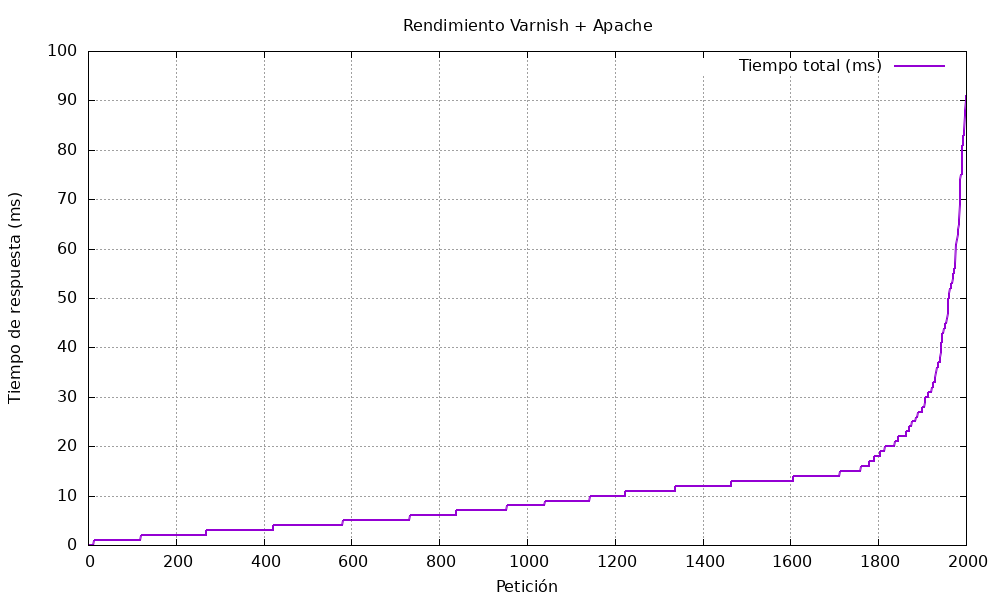

# Francisco López Pizano

## Securización de Apache en AWS (Nginx + Varnish + Certbot + nftables)

### Índice de contenido

1. [Introducción y arquitectura](puntos/01_introduccion.md)
2. [Apache y Varnish (configuración manual)](puntos/02_apache_varnish.md)
3. [HTTPS con Nginx y Certbot (configuración manual)](puntos/03_nginx_certbot.md)
4. [Firewall con nftables: GeoIP y anti-DDoS temporal](puntos/04_nftables_geoip.md)
5. [Pruebas de carga, DDoS y gráficas con Gnuplot](puntos/05_pruebas_ddos.md)
6. [Automatización y restauración (scripts)](puntos/06_automatizacion.md)

### Gráfica de rendimiento

