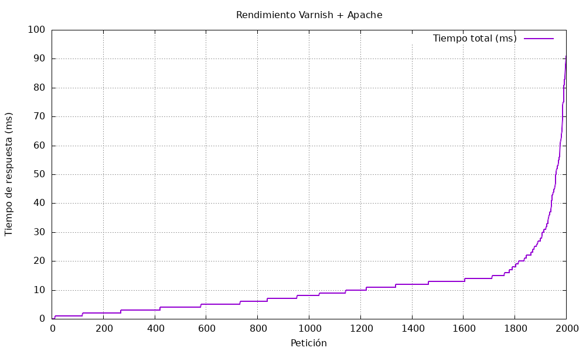

# 5. Pruebas de carga, DDoS y gráficas con Gnuplot

## 5.1 Verificación de servicios y cabeceras

1. **Comprobar puertos escuchando:**
   ```bash
   sudo ss -tulpn | grep -E ':80|:443|:6081|:8080'
   ```
   - `nginx` debe escuchar en `0.0.0.0:80`, `[::]:80`, `0.0.0.0:443` y `[::]:443`.
   - `varnishd` debe escuchar únicamente en `127.0.0.1:6081`.
   - `apache2` debe escuchar únicamente en `127.0.0.1:8080`.

2. **Comprobar respuesta HTTPS sin exponer Apache ni Varnish:**
   ```bash
   curl -I --resolve kikomola.ddns.net:443:127.0.0.1 https://kikomola.ddns.net
   ```

## 5.2 Prueba de ataque DoS / Rate Limiting con ApacheBench (`ab`)

Desde un equipo externo situado en España o Perú:

```bash
ab -n 5000 -c 100 https://kikomola.ddns.net/
```

Mientras se ejecuta, en la instancia EC2 se puede observar:
- **IPs bloqueadas:** `sudo nft list set inet filter banned_ips_v4` (mostrará la IP atacante con `expires 1m59s...`).
- **Estadísticas de Varnish:** `sudo varnishstat -1 | grep -E "MAIN.cache_hit |MAIN.cache_miss "`
- **Peticiones en tiempo real:** `sudo varnishlog -g request -q "ReqMethod eq 'GET'"`

## 5.3 Generación de gráfica con Gnuplot

1. **Exportar resultados con `ab -g`** (por ejemplo en local contra Varnish para medir rendimiento sin que salte el baneo externo):
   ```bash
   ab -n 2000 -c 50 -g resultados.tsv http://127.0.0.1:6081/
   ```

2. **Crear el script `grafica.p` y generar el PNG:**
   ```bash
   cat <<'EOF' > grafica.p
   set terminal png size 1000,600
   set output "grafica_ab.png"
   set title "Rendimiento Varnish + Apache"
   set xlabel "Petición"
   set ylabel "Tiempo de respuesta (ms)"
   set grid
   plot "resultados.tsv" using 9 with lines title "Tiempo total (ms)" lw 2
   EOF

   gnuplot grafica.p
   ```

3. **Descargar la gráfica al equipo local para visualizarla:**
   ```bash
   scp -i clave.pem admin@kikomola.ddns.net:~/grafica_ab.png .
   ```

### Resultado de la prueba


